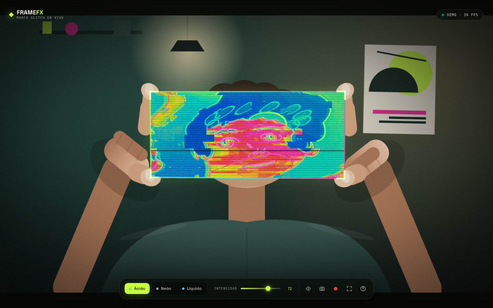

# FRAME FX

Convertí tus manos en un marco: adentro de los dedos aparece una versión
**glitcheada** de lo que enfoca la cámara, en tiempo real.

Es una app web sin build, sin backend y sin subir nada: el modelo de manos, el
shader y la cámara corren enteros en tu equipo.



---

## Correr

```bash
./start.sh          # o: python3 -m http.server 8123
```

Abrí <http://localhost:8123> y tocá **Activar cámara**.

> La cámara solo funciona en `localhost` o en HTTPS. Si querés probarla desde el
> celular, serví la carpeta por HTTPS (por ejemplo con `cloudflared tunnel` o
> `ngrok`) y abrí esa URL.

### Modo demo (sin cámara)

<http://localhost:8123/?demo>

Usa una escena sintética y landmarks falsos. Sirve para ver el efecto si no
tenés cámara o para probar la app en otra máquina.

### Instalar como app (PWA)

La app es instalable y queda disponible **offline** después de la primera carga.

- **Chrome / Edge / Android:** botón **Instalar app** en la portada, o el menú
  del navegador → *Instalar aplicación*.
- **iPhone / iPad:** Compartir → **Añadir a pantalla de inicio**.
- Requiere **HTTPS** (Vercel, GitHub Pages, Cloudflare Pages) o `localhost`.
- El shell (HTML, CSS, JS, fuente, íconos) se precachea al instalar. El modelo de
  manos y el wasm (~17 MB) se guardan la primera vez que usás la cámara; después
  funciona sin red.
- Mientras la app corre pide **Screen Wake Lock** para que la pantalla no se
  apague. Al volver de segundo plano se reactiva sola.

> Al publicar cambios, subí `SHELL_VERSION` en `sw.js`. El navegador solo busca
> una versión nueva del service worker si cambia ese archivo.

### Si en iPhone queda en “Cargando tracker”

En Safari/iOS la app usa automáticamente el delegate **CPU** de MediaPipe,
porque el GPU puede quedarse esperando sin lanzar error. Si igual no arranca:

1. Abrí la app con `?cpu` para forzar CPU explícitamente.
2. Abrí `?reset` para borrar service worker y caches, y volvé a intentar.
3. Actualizá iOS/Safari.
4. Mientras tanto, `?demo` funciona sin tracker.

`?gpu` fuerza el delegate GPU para comparar. El detalle del fallo aparece en la
tarjeta de error y en `?debug` (`window.__fx.trackerError`).

### La cámara arranca antes que el tracker

El clic en **Activar cámara** pide `getUserMedia` de inmediato y recién después
baja el tracker en segundo plano. El detector pesa ~17 MB (wasm + modelo), así
que con red lenta la app se usa igual: los efectos andan sin detección de manos
y el marco aparece cuando termina la descarga.

Si los archivos locales de `vendor/` no llegan en el tiempo previsto, la app
reintenta con la misma versión (0.10.14) desde jsDelivr y Google Storage. Se ve
en consola: `tracker listo con GPU (cdn)`.

### iPhone como cámara (OBS + LensLink)

La app toma cualquier fuente que el sistema exponga como webcam, así que el
iPhone entra a través de OBS:

1. En la Mac/PC, instalá el plugin **[LensLink](https://lenslink.cam/)** en OBS
   Studio; en el iPhone, la app **LensLink Camera**.
2. En OBS agregá una fuente **LensLink Camera** y tocá **Start Camera** en el
   teléfono. Ajustá el encuadre en la escena (la cámara virtual devuelve el
   programa de OBS, no solo la fuente).
3. En OBS: **Iniciar cámara virtual**.
4. Abrí FRAME FX, tocá **Activar cámara** y elegí **OBS Virtual Camera** en el
   selector de la izquierda del dock. La elección queda guardada.

Notas:

- **Linux:** la cámara virtual de OBS necesita `v4l2loopback`:
  `sudo modprobe v4l2loopback exclusive_caps=1 card_label="OBS Virtual Camera"`.
  Si no aparece en el navegador, reinicialo después de cargar el módulo.
- El selector se refresca solo cuando aparece o desaparece un dispositivo
  (`devicechange`), así que podés prender OBS después de abrir la app.
- Si el iPhone se desconecta u OBS frena la cámara virtual, la app avisa y
  podés elegir otra fuente sin recargar.
- El espejo viene activado por defecto (útil para autoview). Con **M** lo
  apagás si querés la imagen tal cual la entrega OBS.
- Calidad: la app elige un perfil según el equipo (en teléfono baja la
  resolución interna, las muestras del shader y la frecuencia del tracker). Si
  no llega a ~27 fps, baja un escalón sola. Para comparar podés forzar un
  perfil con `?q=high`, `?q=mid` o `?q=low`.

---

## Cómo se usa

1. Levantá las dos manos y abrí **pulgar + índice** como una “L”, con los
   índices apuntando hacia arriba.
2. Entre las cuatro puntas queda el marco: el efecto aparece solo ahí y sigue
   tus manos.
3. Ajustá el estilo y la intensidad desde la barra de abajo.
4. Cerrá las dos manos en **puño** para congelar el cuadro; abrirlas vuelve al
   vivo. También podés congelar con `Espacio`.
5. Grabá video o sacá una foto sin marcas de agua.

| Tecla | Acción |
| --- | --- |
| `1`…`6` | Estilo Ácido / Neón / Líquido / VHS / Térmico / Pixel |
| `Espacio` | Congelar / descongelar |
| `R` | Grabar / detener |
| `S` | Foto |
| `M` | Espejar |
| `F` | Pantalla completa |
| `H` | Ocultar interfaz |
| `?` | Ayuda |

**Tips:** luz de frente, manos separadas del cuerpo y sin mangas largas que
tapen los dedos. Si el marco salta, bajá un poco la intensidad.

---

## Qué tiene

- Detección de **hasta 2 manos** con MediaPipe Hand Landmarker (GPU, con
  fallback a CPU).
- Marco armado con las puntas de índice y pulgar, con orden anatómico,
  histéresis, suavizado y tolerancia a pérdidas breves de tracking.
- Efecto WebGL con:
  - deformación líquida y desplazamiento de bloques,
  - aberración cromática y estelas tipo *pixel sorting*,
  - detección de bordes y curvas de nivel,
  - mapa de color ácido (azul → cian → verde → lima → rojo → magenta),
  - scanlines, grano y micro-cortes.
- 6 estilos con personalidad propia + control de intensidad: Ácido, Neón,
  Líquido, VHS, Térmico y Pixel.
- Congelado por gesto (puño con las dos manos) o con `Espacio`, manteniendo el
  cuadro y el efecto quietos.
- Selector de fuente de cámara que recuerda la elección (ideal para **OBS
  Virtual Camera**), con refresco automático al conectar/desconectar dispositivos.
- Espejo, foto PNG y grabación WebM/MP4 con el marco incluido.
- Interfaz responsive y modo demo.
- **PWA instalable**: manifest, service worker, íconos, atajos de app, aviso de
  actualización y wake lock.
- **100 % local**: `vendor/` incluye el wasm, el modelo y la tipografía. En
  runtime no se hace ninguna request externa.

---

## Cómo funciona

### 1. Tracking

MediaPipe devuelve 21 landmarks por mano en coordenadas normalizadas. Cuando
hay dos manos:

- se toman las puntas `4` (pulgar) y `8` (índice) de cada una;
- se exige que pulgar e índice estén abiertos (una “L”) y que el área del
  cuadrilátero sea razonable;
- las manos se ordenan por la muñeca y las puntas se ordenan en ciclo
  anatómico: `índice izq → índice der → pulgar der → pulgar izq`;
- las esquinas se suavizan con un EMA y se mantiene el último marco unos
  instantes si el tracking se corta.

Esto evita el parpadeo típico y permite girar o acercar las manos sin que el
marco se rompa.

### 2. Render

Todo se dibuja en un canvas WebGL:

1. **Pass base:** la cámara espejada, con viñeta y grano suave.
2. **Pass del marco:** se dibuja el cuadrilátero de las cuatro puntas con un
   shader que muestrea la misma textura y le aplica el glitch.

El shader usa el tiempo cuantizado (para que el glitch “salte” como un
datamosh), ruido de valor, bordes por diferencias de luma y un gradiente de
color. El borde neón y las esquinas se dibujan en un canvas 2D encima.

La grabación compone los dos canvases en un tercero y lo captura con
`MediaRecorder`; por eso el video sale con marco y todo.

---

## Deploy

### Vercel

[](https://vercel.com/new/clone?repository-url=https%3A%2F%2Fgithub.com%2FSantiagoCordobaG%2FCamera-live)

Importá el repositorio en Vercel con framework **Other**, sin build command y
con el root del proyecto como output. Es estático, así que también podés usar:

```bash
npx vercel --prod
```

`vercel.json` ya deja `sw.js` sin cache agresivo, el manifest con su
`Content-Type` correcto y headers básicos de seguridad.

### GitHub Pages

Como las rutas son relativas (`./`), funciona publicado en una subcarpeta:

```bash
git push origin main
```

y en **Settings → Pages** elegí la rama `main` y la carpeta `/ (root)`.

> HTTPS es obligatorio para la cámara y para instalar la PWA.

---

## Estructura

```
index.html              UI y estructura
manifest.webmanifest    metadatos de la PWA
sw.js                   precache del shell + cache del tracker
vercel.json             headers para Vercel
css/style.css           estilos, responsive, tipografía
js/main.js              cámara, tracking, loop, grabación
js/shaders.js           shaders GLSL del efecto
js/demo.js              escena sintética para ?demo
js/pwa.js               instalación, updates y wake lock
icons/                  íconos 192/512, maskable y apple-touch
vendor/mediapipe/       wasm + runtime de MediaPipe (local)
vendor/models/          hand_landmarker.task (local)
vendor/fonts/           Space Grotesk (local)
docs/preview.png        captura de la app
start.sh                servidor local
```

No hay `npm install` ni paso de compilación: es HTML + módulos ES.

---

## Ideas para seguir

- Control por gestos: distancia entre manos → intensidad, inclinación → paleta.
- Exportar solo lo que está dentro del marco, rectificado a 1:1 o 9:16.
- Clip corto listo para redes (4–6 s) además de la grabación libre.
- Calibración de confianza del tracker desde la UI.
- Presets compartibles por URL.

---

## Créditos

- [MediaPipe Hand Landmarker](https://ai.google.dev/edge/mediapipe/solutions/vision/hand_landmarker) — tracking de manos.
- [sophiamyang/finger-frame-effect](https://github.com/sophiamyang/finger-frame-effect) — referencia del gesto, orden de esquinas e histéresis.
- [Kartik281204/Hand-Frame-FX](https://github.com/Kartik281204/Hand-Frame-FX) — otra implementación del mismo concepto en Python/OpenCV.
- [Space Grotesk](https://fonts.google.com/specimen/Space+Grotesk) — tipografía.

Hecho para jugar. 🫱🫲
